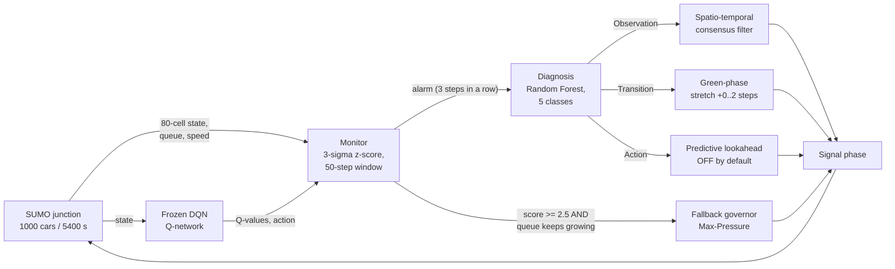
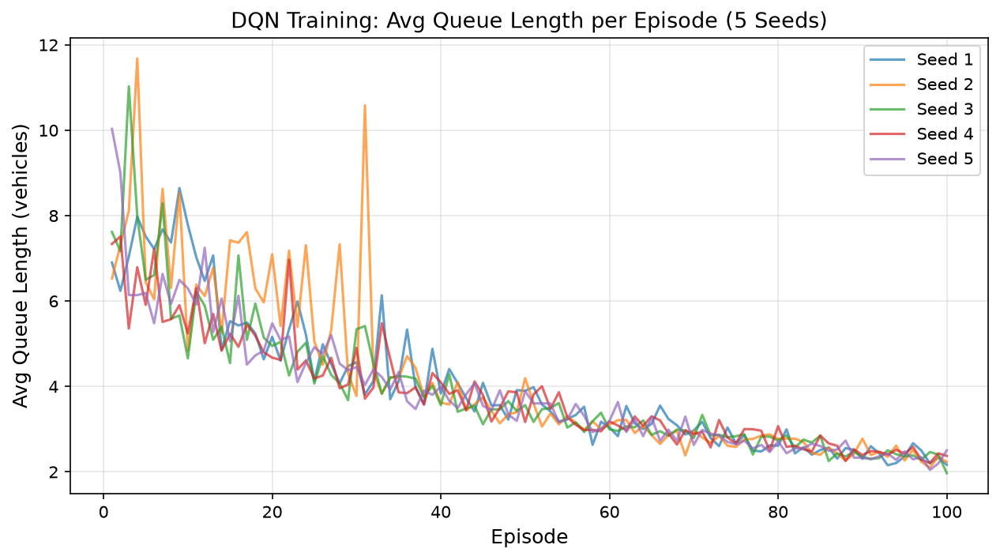
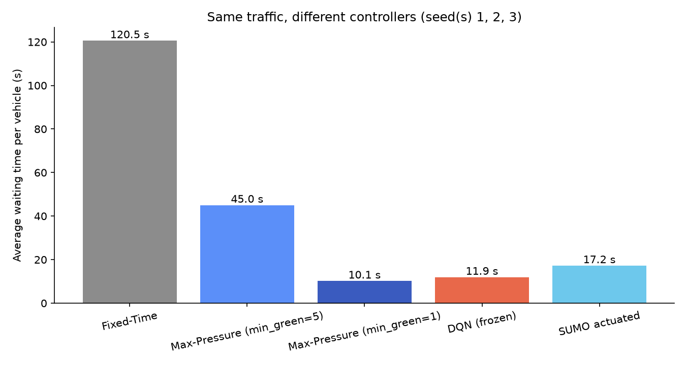
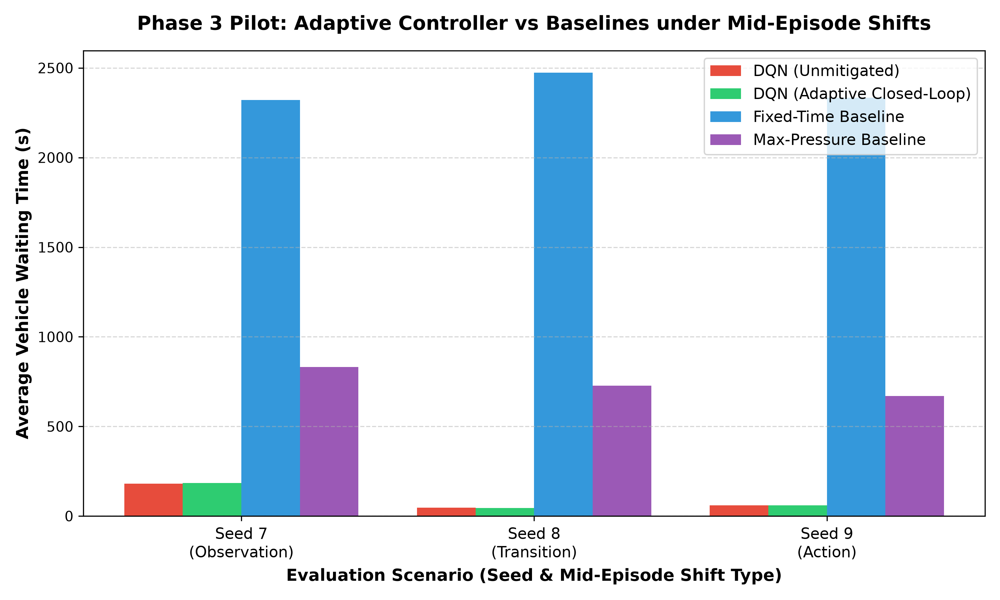

# Resilient Reinforcement Learning for Traffic Signal Control
### Detecting, diagnosing and mitigating distribution shift for a DQN traffic-light controller in SUMO

A Deep Q-Network (DQN) learns to run the traffic light at a simulated 4-way junction. Like any learned
controller, it can fail quietly when the world changes in ways it never saw during training: broken
sensors, slippery roads, laggy signal hardware, or a changed objective. Each of these is a *distribution
shift*. This project adds a safety layer around the trained agent. A **monitor** spots unusual behaviour,
a **diagnosis** classifier guesses what kind of shift happened, a **mitigation** module applies a matching
fix, and a **fallback** hands control to a classical Max-Pressure rule if queues keep growing.
Everything runs in the open-source traffic simulator **Eclipse SUMO**. The trained models are included,
so nothing has to be retrained.

> **Status.** This is a course project. The trained agent and the monitor work as reported. The
> diagnosis classifier **misses its target** (80.08% vs 85%), action mitigation is **switched off**
> because it was measured as harmful, and the closed-loop evaluation (Phase 3) is a **3-seed pilot**.
> See [Known limitations](#known-limitations).

---

## Contents
1. [Quick Start (5 steps)](#quick-start-5-steps)
2. [What each script does](#what-each-script-does)
3. [Expected output](#expected-output)
4. [How it works](#how-it-works) (architecture, MDP, DQN settings, shift types)
5. [Results](#results)
6. [Known limitations](#known-limitations)
7. [Troubleshooting](#troubleshooting)
8. [Folder structure](#folder-structure)
9. [Team](#team) · [Credits and related work](#credits-and-related-work) · [License](#license)

---

## Quick Start (5 steps)

These steps were tested on Windows 11 by running them, exactly as written, in a freshly cloned folder.

**1. Install Python 3.11.**
Download it from <https://www.python.org/downloads/release/python-3119/> ("Windows installer (64-bit)").
In the installer, tick **"Add python.exe to PATH"**. Python 3.10 and 3.12 also work. **3.13 and newer do
not**, because the saved diagnosis classifier needs scikit-learn 1.5.0.

**2. SUMO 1.27.1 (the traffic simulator) is installed automatically in step 4.**
It comes from the official `eclipse-sumo` pip package, so you don't need to do anything here.
*(Optional: if you already have SUMO 1.27.1 installed with `SUMO_HOME` set, that copy is used instead.
Installer: <https://sumo.dlr.de/docs/Downloads.php>.)*

**3. Download the project.** Open **PowerShell** and run:
```powershell
git clone https://github.com/vivekreddy1730/rl-traffic-resilience.git
cd rl-traffic-resilience
```
(No git? On the GitHub page click **Code → Download ZIP**, unzip it, and `cd` into the unzipped folder.)

**4. Run the setup.** It creates a virtual environment in `.venv`, installs the pinned packages
(about 1 GB the first time), checks SUMO and runs a short test simulation:
```powershell
powershell -ExecutionPolicy Bypass -File .\setup.ps1
```
Wait for the green **`SETUP OK`**.

**5. Run the demo.** A SUMO window opens and you watch the trained agent control the junction:
```powershell
.\.venv\Scripts\Activate.ps1
python run_demo.py
```
If `Activate.ps1` is blocked, skip it and call the venv's Python directly:
`.\.venv\Scripts\python.exe run_demo.py`. Without a window: `python run_demo.py --nogui`.

> **Linux / macOS (not tested by us):** `bash setup.sh`, then `source .venv/bin/activate` and the same
> `python ...` commands. Paths are portable and SUMO comes from pip, so it should work, but we could only
> test on Windows.

---

## What each script does

Every script has `--help`. Defaults are short: each takes seconds to a few minutes.

| Command | What it does | Time* |
|---|---|---|
| `python run_demo.py` | One episode (1000 cars, 5400 simulated s) controlled by the trained DQN in the **SUMO-GUI window**. Prints the average waiting time per vehicle and compares it with the stored value. `--nogui` runs headless; `--seed 1..5` picks traffic and model; `--delay` sets animation speed. | ~15 s headless, 1–3 min GUI |
| `python run_comparison.py` | **Fixed-Time vs Max-Pressure (two settings) vs DQN** on identical traffic. Prints a table with the stored values next to the new ones and saves a chart to `results/demo_outputs/`. `--seeds 1 2 3` reproduces the full stored table; `--include-actuated` adds SUMO's built-in actuated light. | ~30 s per seed |
| `python run_adaptive_demo.py --shift observation` | Full pipeline **Monitor → Diagnosis → Mitigation → Fallback**. Injects one shift mid-episode (`observation`, `transition`, `action` or `reward`), prints when it was detected, what it was diagnosed as and what the controller did, then compares with the unprotected DQN. | ~30–60 s |
| `python run_all_checks.py` | Runs the verification scripts and prints **PASS/FAIL**. `--full` also re-runs the Phase 2 + 3 experiments from scratch (into a temp folder) and checks that every stored number is reproduced. | ~1 min (quick), ~20–30 min (`--full`) |
| `python RUN_SIMULATION.py` | Interactive GUI launcher from the original project (asks which controller and speed). | – |
| `python tests/run_phase1_dqn.py` | *Optional* retraining of the DQN (5 seeds × 100 episodes). Writes to `results/retrain_phase1/`; never overwrites the shipped models. | hours |

\*Measured on the laptop used for testing (Windows 11, CPU only).

---

## Expected output

`python run_demo.py --nogui` (seed 1):
```
  Finished in 10.1 s of real time, 428 signal decisions.
  Vehicles that completed their trip : 999
  AVERAGE WAITING TIME PER VEHICLE   : 13.65 s
  Stored result for seed 1 (results/final_checks): 13.65 s  -> difference +0.00 s (exact match)
```

`python run_comparison.py --seeds 1 2 3 --include-actuated` (all 15 values matched the stored CSV exactly):
```
  Controller                   Seed Vehicles  Avg wait (s/veh)  Avg travel (s)  Stored wait
  Fixed-Time                      1      999            120.16          244.17       120.16
  Max-Pressure (min_green=5)      1      999             47.01          169.05        47.01
  Max-Pressure (min_green=1)      1      999             11.44          133.52        11.44
  DQN (frozen)                    1      999             13.65          136.16        13.65
  SUMO actuated                   1      999             17.54          141.06        17.54
  ... (seeds 2 and 3)
```

`python run_adaptive_demo.py --shift observation` (seed 7, same as the Phase 3 pilot):
```
  [decision 120, t=1634s] >>> SHIFT INJECTED: observation
  [decision 172, t=2318s] score=2.18 alarm=YES diagnosis=Observation fallback=off action-taken=SpatialTemporal_Filter
  ...
    Shift detected?                   : YES, first alarm at decision 172 (52 decisions after injection)
    DQN + adaptive controller :    184.08 s
    Plain DQN, no protection  :    180.66 s
    Difference                : +1.90%  (negative = adaptive controller helped)
    Stored pilot result (results/phase3_pilot): plain DQN 180.66 s, adaptive 184.08 s
```
In this run the adaptive controller did **not** help. This is the honest pilot result; see the results below.

> Small differences (a few hundredths of a second) are possible on other CPUs or SUMO versions. On the test
> machine every reproduced number matched exactly.

---

## How it works

### Architecture



ASCII version:
```
 SUMO ──state──► DQN ──Q,action──► MONITOR ──alarm──► DIAGNOSIS ──class──► MITIGATION ──┐
  ▲                                   │                                                   │
  │                                   └──severe + queue growing──► FALLBACK (Max-Pressure)┤
  └──────────────────────────────── chosen signal phase ◄──────────────────────────────────┘
```
Code: `src/monitor.py`, `src/diagnosis.py`, `src/mitigation.py`, `src/adaptive_controller.py`; shifts are
injected by `src/shifts.py`.


### MDP design (Vidali base environment, unchanged)

| Element | Definition |
|---|---|
| **Junction** | One 4-way intersection, 750 m approaches, 4 incoming lanes per arm (`intersection/environment.net.xml`). |
| **State** | **80-cell binary vector**: 8 lane groups × 10 distance cells (cells get longer further from the light: 7, 14, 21, 28, 40, 60, 100, 160, 400, 750 m). A cell is 1 if a car is in it. |
| **Actions** | **4 green phases**: North–South straight/right, North–South left, East–West straight/right, East–West left. A 4 s yellow is inserted when the phase changes; each green lasts 10 s. |
| **Reward** | **Change in total waiting time**: `r_t = W_{t-1} − W_t`, where `W` is the summed accumulated waiting time of cars on the incoming roads. Less waiting gives a higher reward. |
| **Traffic** | 1000 cars per episode with Weibull-distributed arrival times; 75% go straight, 25% turn. Episode = 5400 simulated seconds. Route seed = `seed × 10000`. |

### DQN settings (`Deep-QLearning-Agent-for-Traffic-Signal-Control/settings/training_settings.yaml`)

| Setting | Value |
|---|---|
| Network | MLP: 80 → 400 → (4 × 400 hidden, ReLU) → 4 Q-values |
| Optimiser / loss | Adam, learning rate 0.001 / mean-squared error |
| Discount γ | 0.75 |
| Replay memory | 600 (min) to 50 000 (max) samples; batch size 100 |
| Training | 100 episodes per seed, 800 gradient steps after each episode, ε decays linearly 1.0 → 0 |
| Target | `r + γ · max Q(s′, ·)` from the same network (Vidali's design, no separate target network) |
| Seeds | 5 independent training seeds → `models/seed_1 … seed_5` (frozen, ε = 0 at evaluation) |

### Shift types (`src/shifts.py`, following the S/T/A/R taxonomy of Sim2Signal)

| Shift | What changes | Setting used in the evaluations |
|---|---|---|
| **Observation** (sensor fault) | Bits in the 80-cell state are randomly flipped and some cells are blanked | 20% flip probability, cells 0–19 zeroed |
| **Transition** (vehicle dynamics) | Cars drive slower and brake more weakly (e.g. rain or ice) | 50% max speed, 50% deceleration |
| **Action** (actuator lag) | The signal executes each command late | 1 decision step of latency |
| **Reward** (objective change) | Reward gets extra penalties | switch penalty 10, queue-imbalance weight 2 |

---

## Results

All numbers below are copied from files in `results/`. Run `python run_all_checks.py --full` to regenerate them.

> ⚠️ **The phases use different waiting-time metrics. Do not compare numbers across tables.**
> * **Phase 1:** *queue-sum per decision step* (halted cars summed over each second, divided by the number of decisions).
> * **Per-vehicle check:** *seconds of waiting per vehicle* from SUMO's trip statistics (tripinfo).
> * **Phase 2 / 3:** *mean cumulative waiting time* (`W`, averaged over decision steps).

### Phase 1: DQN vs classical baselines (5 seeds, Phase 1 metric)
Source: `results/phase1_baseline_v2/summary_all.csv`

| Controller | Avg waiting time (Phase 1 metric) | Avg queue length (cars) |
|---|---|---|
| **DQN, frozen (ε = 0)** | **28.93 ± 2.43** | 2.27 ± 0.24 |
| DQN, last 10 training episodes | 30.34 ± 1.77 | 2.36 ± 0.15 |
| Max-Pressure (min_green = 10 decisions) | 172.95 ± 7.18 | 16.74 ± 0.73 |
| Fixed-Time (10 s per phase) | 236.66 ± 8.33 | 22.79 ± 0.80 |



### Per-vehicle check (seeds 1–3, seconds per vehicle)
Source: `results/final_checks/metric_independent_baselines.csv` (mean ± std over 3 seeds)

| Controller | Avg waiting time per vehicle | Avg travel time |
|---|---|---|
| Max-Pressure, min_green = 1 (10 s hold) | **10.14 ± 0.98 s** | 131.94 s |
| **DQN, frozen** | 11.88 ± 1.28 s | 133.86 s |
| SUMO built-in actuated | 17.19 ± 0.25 s | 140.78 s |
| Max-Pressure, min_green = 5 | 45.00 ± 1.48 s | 166.89 s |
| Fixed-Time | 120.53 ± 2.31 s | 244.62 s |

Under the per-vehicle metric, a **well-tuned Max-Pressure (min_green = 1) beats the DQN**. The large
DQN advantage in the Phase 1 table depends on the baseline's setting (min_green = 10) and on the metric.



### Phase 2: Monitor, diagnosis, mitigation (held-out seeds 4–5 unless stated)
Sources: `results/phase2_shifts/*.json`

| Component | Result |
|---|---|
| Monitor (3-sigma, threshold 2.1699, 50-step window, 3 consecutive alarms) | **TPR 100%** on all 4 shift types, **FPR 0%** on nominal traffic. Detection latency 16.5 / 18.5 / 91.5 / 11.0 decision steps (Obs / Trans / Action / Reward) |
| Diagnosis (Random Forest, 5 classes, trained on seeds 1–3) | **80.08%** accuracy on seeds 4–5 (**target 85% not met**); 89.05% on confirmatory seed 6. Weakest class: Nominal (recall 36.6%) |
| Observation mitigation | recovery **+15.96%** (seed 7 confirmatory: +44.43%) |
| Transition mitigation | recovery **+21.99%** |
| Action mitigation | recovery **−46.62%** (harmful) → **disabled by default** |
| Fallback governor (synthetic "policy collapse": inverted Q-values) | recovery **+99.79%**; the mitigated wait (2825.7) is still about 61× nominal (46.2) |
| False-fallback rate on nominal seeds 1–3 | 0.0% |
| Misrouting test (action mitigation applied to *nominal* traffic) | waiting time +87.97% (why it is gated off) |

Recovery ratio ρ = (unmitigated − mitigated) / (unmitigated − nominal). 100% means fully back to nominal; negative means the mitigation made things worse.

### Phase 3 (pilot): closed-loop controller vs baselines (seeds 7, 8, 9)
Source: `results/phase3_pilot/phase3_pilot_summary.csv` (Phase 2/3 metric; shift injected at decision step 120)

| Seed / shift | DQN unprotected | **DQN + adaptive** | Max-Pressure (min_green=5) | Fixed-Time |
|---|---|---|---|---|
| 7 / Observation | 180.66 | 184.08 (+1.9%) | 831.38 | 2321.26 |
| 8 / Transition | 46.12 | 45.42 (−1.5%) | 727.62 | 2472.96 |
| 9 / Action | 59.12 | 59.12 (0%) | 670.24 | 2333.50 |

The fallback never triggered (0%) in the pilot. **The adaptive layer did not meaningfully improve on
the unprotected DQN.** A follow-up observation-shift sweep over 10 seeds
(`results/phase3_pilot_extra/observation_filter_10seed_sweep.csv`) detected the shift in 6 of 10 seeds
only, and the classifier's dominant label was "Nominal" in all 10.



---

## Known limitations

* **Diagnosis classifier accuracy is 80.08% on held-out seeds 4–5; the target was 85%.**
  `tests/verify_phase2_diagnosis.py` therefore still fails its own 85% assertion, and
  `run_all_checks.py --full` marks it `PASS*` (reproduced exactly, but below target).
* **Action mitigation is OFF by default** (`enable_action_mitigation=False`) because it was measured as
  harmful (recovery −46.62%; +87.97% waiting time when misapplied to normal traffic). It can be switched
  on for experiments with `run_adaptive_demo.py --enable-action-mitigation`.
* **Phase 3 is a pilot** with three seeds (7, 8, 9), one shift per seed and one model (seed 1). It is not
  a full validation, and in it the adaptive controller performed about the same as the plain DQN.
* **The Phase 1 waiting-time metric differs from the Phase 2/3 metric** (and from the per-vehicle
  metric). Do not compare numbers across phases.
* The monitor's 100% TPR comes from the Phase 2 test setting. In the mid-episode 10-seed observation sweep it
  detected the shift in only 6 of 10 seeds.
* Under the per-vehicle metric, a tuned Max-Pressure (min_green = 1) has lower waiting time than the DQN.
* Results come from one simulated junction with synthetic traffic. Nothing here was tested on real traffic.
* Some JSON result files contain absolute paths from the original laptop in informational fields
  (e.g. `model_path`). They were left untouched on purpose (result files are not edited) and are not used by any code.

---

## Troubleshooting

**"SUMO (the traffic simulator) could not be found" / SUMO_HOME not set**
Normally SUMO comes from pip (`eclipse-sumo==1.27.1`), and `SUMO_HOME` is **not** needed. Re-run
`python -m pip install -r requirements.txt` inside the venv. If you prefer your own SUMO install, set
`SUMO_HOME` to its folder (the one containing `bin\sumo.exe`): `setx SUMO_HOME "C:\path\to\sumo-1.27.1"`,
then open a **new** terminal. A wrong `SUMO_HOME` is ignored when it has no `bin\sumo.exe`, and the pip copy is used instead.

**`sumo.exe` / `sumo-gui.exe` "blocked by Application Control policy" (Windows 11 Smart App Control)**
Smart App Control can block unsigned programs. On the test laptop it blocked the SUMO installed with the
Windows *installer*, but **not** the pip-installed SUMO used by default. If it still blocks, use the pip
SUMO (unset `SUMO_HOME`), or add an exception in *Windows Security → App & browser control*.

**The SUMO-GUI window does not open**
* Use `python run_demo.py --nogui` and every other script (they are headless anyway). You still get all the results.
* Make sure the window is not hidden behind other windows. It starts automatically and closes at the end
  (`--keep-open` keeps it open).
* Remote desktop or virtual machines sometimes lack OpenGL. Use `--nogui` there.
* macOS needs XQuartz for sumo-gui, and some macOS versions have known sumo-gui crashes. Use `--nogui`.

**Do not run two simulations at the same time from the same folder.** All scripts write the generated
traffic to the same file (`Deep-QLearning-Agent-for-Traffic-Signal-Control/intersection/episode_routes.rou.xml`,
as in Vidali's original code). Two parallel runs overwrite each other's traffic and give wrong numbers.

**PyTorch install problems**
* "No matching distribution found for torch==2.13.0": your Python is too new or too old. Use Python 3.11 (3.10–3.12).
* Slow or huge download on Linux: install the CPU wheel first:
  `pip install torch==2.13.0 --index-url https://download.pytorch.org/whl/cpu` (`setup.sh` does this).
* Windows "DLL load failed" when importing torch: install the
  [Microsoft Visual C++ Redistributable (x64)](https://aka.ms/vs/17/release/vc_redist.x64.exe) and retry.

**"running scripts is disabled on this system"**
Start the setup with `powershell -ExecutionPolicy Bypass -File .\setup.ps1`. Instead of activating the venv, call
`.\.venv\Scripts\python.exe <script>` directly.

**scikit-learn "InconsistentVersionWarning" or the classifier fails to load**
The classifier was saved with scikit-learn 1.5.0. Install exactly the versions in `requirements.txt`.

---

## Folder structure

```
.
├── run_demo.py              # watch the trained DQN (SUMO-GUI or --nogui)
├── run_comparison.py        # Fixed-Time vs Max-Pressure vs DQN, table + plot
├── run_adaptive_demo.py     # Monitor -> Diagnosis -> Mitigation -> Fallback with one injected shift
├── run_all_checks.py        # verification scripts -> PASS/FAIL (--full re-runs experiments)
├── RUN_SIMULATION.py        # original interactive GUI launcher
├── setup.ps1 / setup.sh     # one-time setup (Windows / Linux-macOS)
├── requirements.txt         # pinned package versions (incl. SUMO 1.27.1 via pip)
├── src/                     # our code
│   ├── project_paths.py     #   portable paths + SUMO discovery (used by every script)
│   ├── shifts.py            #   S/T/A/R shift injection (Sriram)
│   ├── monitor.py           #   3-sigma shift monitor (Sriram)
│   ├── diagnosis.py         #   Random-Forest shift diagnosis (Sriram)
│   ├── mitigation.py        #   filters, phase stretch, fallback governor (Vivek Reddy)
│   ├── adaptive_controller.py #  closed-loop controller (Vivek Reddy)
│   └── run_visual_gui.py    #   GUI runner used by RUN_SIMULATION.py
├── baselines/run_baselines.py   # Fixed-Time + Max-Pressure controllers (Ayyappa Reddy)
├── Deep-QLearning-Agent-for-Traffic-Signal-Control/   # Vidali's base code (MIT), comments added only
│   ├── src/tlcs/            #   DQN agent, model, environment, route generator
│   ├── settings/            #   training_settings.yaml (DQN hyper-parameters)
│   └── intersection/        #   SUMO network (environment.net.xml) + config (sumo_config.sumocfg)
├── models/seed_1..5/trained_model.pt   # frozen trained DQN weights (no retraining needed)
├── results/
│   ├── phase1_baseline_v2/  # Phase 1 (final): CSVs, plots, phase1_report.md
│   ├── phase1_baseline/     # Phase 1 v1 (historical; Max-Pressure had a left-turn bug, fixed in v2)
│   ├── phase2_shifts/       # calibration profile, classifier, monitor/diagnosis/mitigation summaries
│   ├── phase3_pilot*/       # Phase 3 pilot + nominal + extra sweeps
│   ├── final_checks/        # per-vehicle (tripinfo) baseline check + monitor grid studies
│   └── diagnostics/         # Max-Pressure action-histogram diagnostics
├── tests/                   # verify_*.py scripts, phase runners, check_setup.py
├── docs/                    # final paper, presentations, code documentation, phase 1 report, images
└── report/                  # LaTeX source of the paper (IEEE Access template)
```

The SUMO network, route and config files live in `Deep-QLearning-Agent-for-Traffic-Signal-Control/intersection/`
rather than a separate `sumo/` folder. Vidali's code loads them from that relative path, and moving them would
mean changing the base code. The route file is regenerated before every run.

---

## Team

All members had equal standing. Work was divided along the data flow:

| Member | Roll number | Parts |
|---|---|---|
| **Ayyappa Reddy** | AM.SC.U4AIE23046 | SUMO setup, DQN training (5 seeds), baselines (Fixed-Time, Max-Pressure incl. left-turn fix) |
| **Sriram** | AM.SC.U4AIE23014 | Shift injection engine, shift monitor, diagnosis classifier |
| **Vivek Reddy** | AM.SC.U4AIE23050 | Mitigation modules, fallback governor, closed-loop adaptive controller |

---

## Credits and related work

* **Base code:** Andrea Vidali, *Deep Q-Learning Agent for Traffic Signal Control*,
  <https://github.com/AndreaVidali/Deep-QLearning-Agent-for-Traffic-Signal-Control> (MIT License).
  The DQN agent, network, SUMO intersection and route generator come from this repository. We only added
  comments to those files; the logic is unchanged. Its original README and LICENSE are kept in that folder.
* **Simulator:** Eclipse SUMO 1.27.1, <https://eclipse.dev/sumo/>.

Related work that informed this project (cited as related work only; we make no claim to be first):
* **RobustLight**: Li et al., *RobustLight: Robust Reinforcement Learning for Traffic Signal Control Under Perturbations* (2025).
* **Sim2Signal**: Al Rafi, Zhang & Sharon, *Sim2Signal: Detecting and Diagnosing Distribution Shift in
  Simulation-to-Reality Traffic Control* (2026). Our Observation / Transition / Action / Reward shift taxonomy follows it.
* **RESCO**: *Reinforcement Learning Benchmarks for Traffic Signal Control* (Ault & Sharon, NeurIPS 2021
  Datasets and Benchmarks), a standard SUMO benchmark suite for traffic-signal RL.

Full references (except RESCO) are in `report/references.bib` and the paper in `docs/Final_Paper.pdf`.

## License

MIT. See [LICENSE](LICENSE). The base code by Andrea Vidali is also MIT-licensed; its copyright notice is kept.
